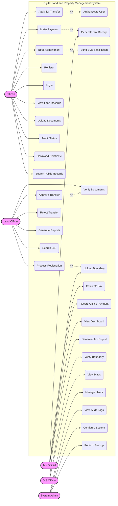
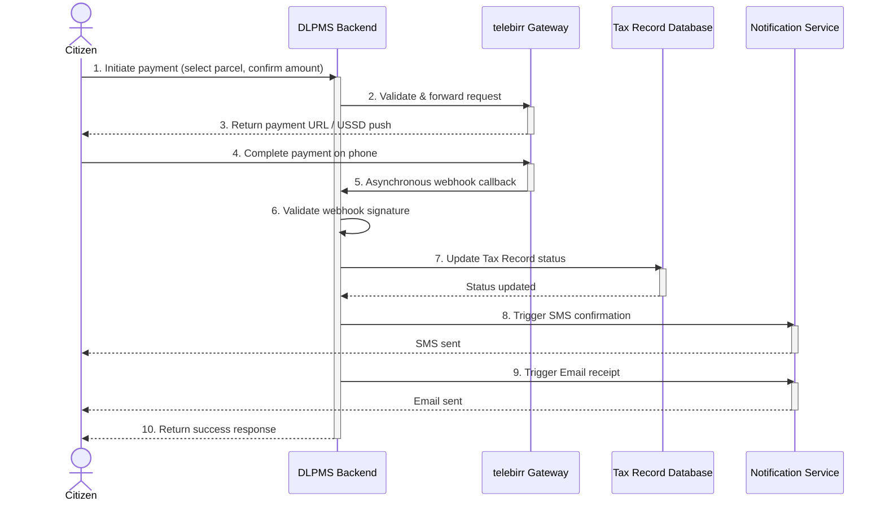
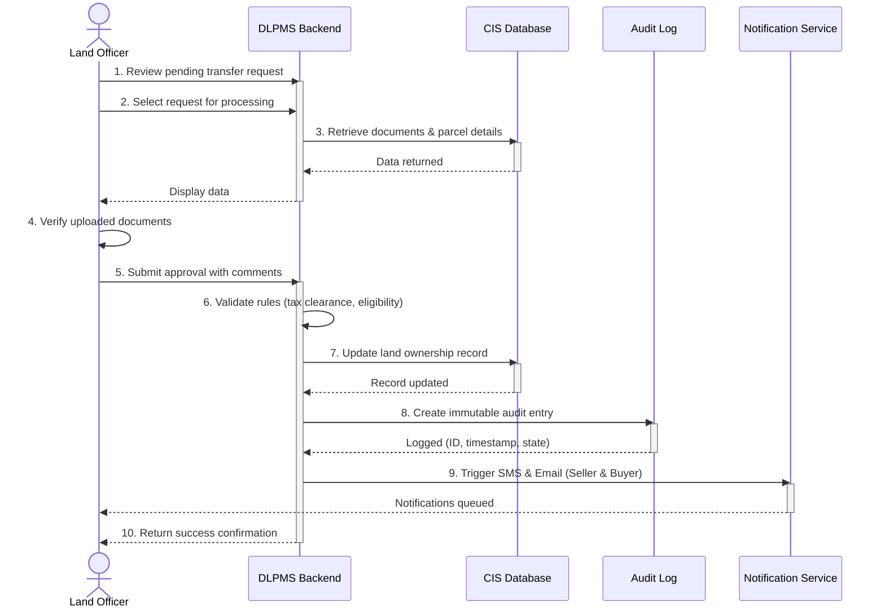
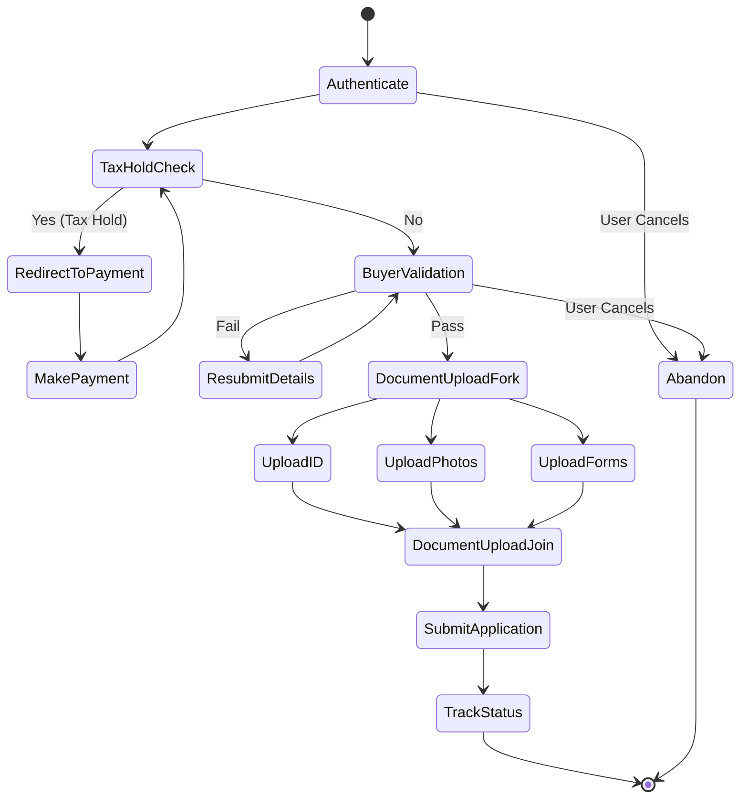
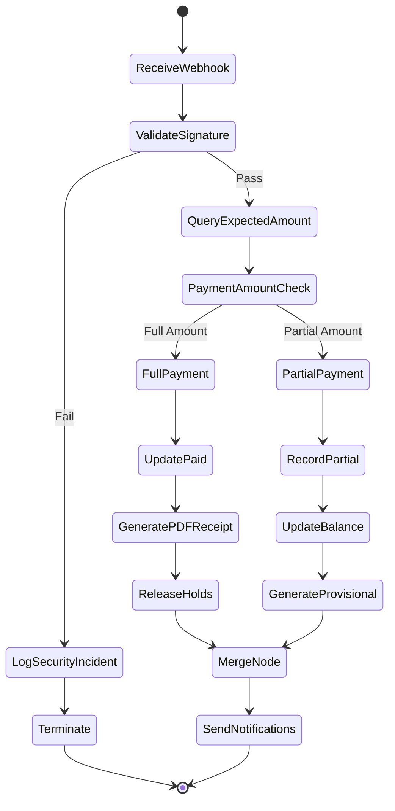
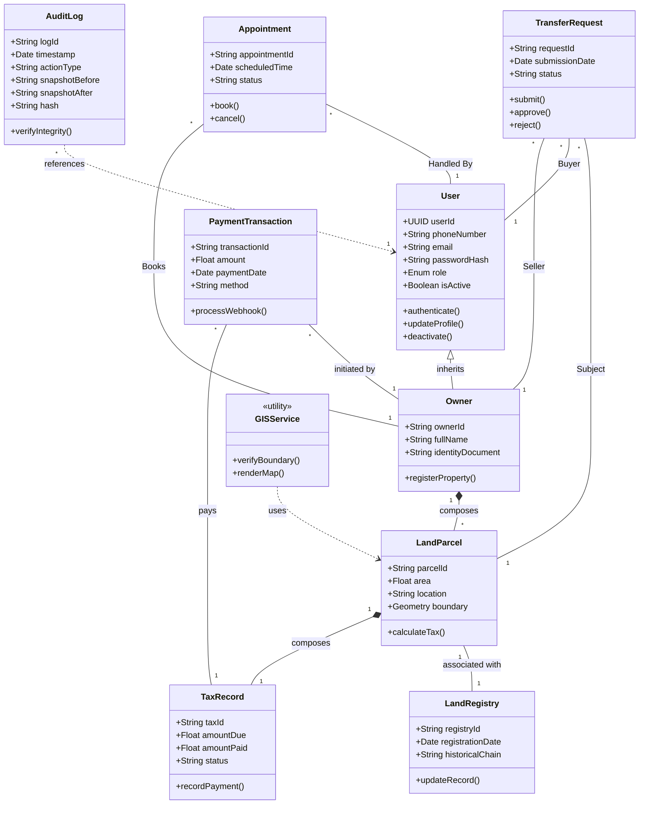

# CHAPTER THREE: SYSTEM ANALYSIS

This chapter presents a comprehensive system analysis for the Digital Land and Property Management System (DLPMS). It begins with an overview of the proposed system and its relationship with the existing Cadastral Information System (CIS) at the Dire Dawa Land Administration (DDLA). The chapter then details both the functional and non-functional requirements elicited through stakeholder interviews, document analysis, and observation studies as described in Chapter Two. Finally, system modeling using UML diagrams—including use case diagrams, sequence diagrams, activity diagrams, and a class diagram—is presented to provide a visual specification of the system's behavior and structure.

## 3.1 Overview of the Proposed System

The Digital Land and Property Management System (DLPMS) is designed to enhance and extend the capabilities of the existing Cadastral Information System (CIS) currently operational at the Dire Dawa Land Administration (DDLA). The existing CIS consists of four primary modules: the Archives module for document management, the GIS module for spatial data visualization, the BILE (Building Inspection and Land Evaluation) module for property assessment, and the Property Evaluation module for valuation purposes. While the CIS has served as the backbone of land administration operations, it lacks citizen-facing digital services, automated payment integration, and comprehensive audit capabilities.

The DLPMS introduces four new components that integrate seamlessly with the existing CIS infrastructure:

1. **Citizen Service Portal:** A responsive web application and mobile app built with React.js and Tailwind CSS that allows citizens to register, view their land records, apply for land transfers, upload supporting documents, track application status, download certificates, and search public land records. The portal is designed as a Progressive Web App (PWA) to ensure offline-capable access on mobile devices.
2. **Integrated Payment Gateway:** A telebirr mobile money integration module that enables citizens to make property tax payments directly through the DLPMS. The payment gateway handles secure transaction processing, webhook signature validation, automatic receipt generation, and real-time status updates. This eliminates the need for citizens to physically visit the tax office for routine payments.
3. **Comprehensive Audit Logging:** A tamper-evident logging system that records every CRUD operation performed within the DLPMS. Each audit entry includes a cryptographic hash chain to ensure immutability, along with metadata such as the timestamp, user ID, IP address, action type, and before/after snapshots of modified data. This component is critical for regulatory compliance and accountability.
4. **Appointment Scheduler:** An online booking system that allows citizens to schedule appointments with land officers for in-person document verification and consultations. The scheduler supports time-slot management, automated SMS and email reminders sent 24 hours before the scheduled appointment, and integration with the officer's calendar to prevent double-booking.

The technology stack selected for the DLPMS comprises React.js with Tailwind CSS for the frontend user interface, Node.js with Express.js for the backend REST API server, PostgreSQL with the PostGIS spatial extension for the database layer, and Leaflet.js for interactive map rendering. Authentication is implemented using JSON Web Tokens (JWT) with role-based access control (RBAC) to ensure that users can only access features appropriate to their assigned roles.

The new system integrates with the existing CIS database through a RESTful API layer, enabling seamless data exchange between the legacy system and the modern web-based portal. This integration approach ensures that the DLPMS can leverage the existing spatial data, land records, and property information stored in the CIS without requiring a complete system migration, thereby reducing implementation risk and cost while maintaining operational continuity.

## 3.2 System Requirements

This section presents the complete set of system requirements for the DLPMS, categorized into functional requirements (what the system must do) and non-functional requirements (how the system should behave). These requirements were elicited from stakeholders including land officers, tax officials, GIS officers, system administrators, and citizens through the methods described in Chapter Two.

### 3.2.1 Functional Requirements

A total of 36 functional requirements have been identified for the DLPMS. These requirements are organized by the primary actor responsible for initiating or interacting with each function. Table 3.1 presents the complete functional requirements specification with their associated actors and priority levels.

**Table 3.1: Functional Requirements Specification**

| Req ID | Requirement Description | Actor | Priority |
|---|---|---|---|
| FR-01 | Register as a citizen with personal details and phone number | Citizen | High |
| FR-02 | Login using phone number or email with password and OTP verification | Citizen | High |
| FR-03 | View land records and property details associated with their account | Citizen | High |
| FR-04 | Apply for land ownership transfer by submitting required documents | Citizen | High |
| FR-05 | Upload supporting documents (ID, photos, forms) in PDF or image format | Citizen | High |
| FR-06 | Track the status of submitted applications in real-time | Citizen | Medium |
| FR-07 | Download digitally signed land ownership certificates in PDF format | Citizen | High |
| FR-08 | Book appointments with land officers for in-person verification | Citizen | Medium |
| FR-09 | Make property tax payments via telebirr mobile money integration | Citizen | High |
| FR-10 | Search public land records by parcel ID, owner name, or location | Citizen | Medium |
| FR-11 | Process new land registration applications submitted by citizens | Land Officer | High |
| FR-12 | Verify uploaded documents for authenticity and completeness | Land Officer | High |
| FR-13 | Approve land transfer requests after verification and validation | Land Officer | High |
| FR-14 | Reject land transfer requests with documented reasons | Land Officer | High |
| FR-15 | Generate comprehensive reports on land registrations and transfers | Land Officer | Medium |
| FR-16 | Search and retrieve land records from the CIS database | Land Officer | Medium |
| FR-17 | Calculate property tax based on land area, location, and property type | Tax Official | High |
| FR-18 | Record manual offline payments received at the office counter | Tax Official | High |
| FR-19 | View a dashboard with tax collection summaries and outstanding dues | Tax Official | Medium |
| FR-20 | Generate official tax receipts for both online and offline payments | Tax Official | High |
| FR-21 | Generate tax compliance reports by period and sub-city | Tax Official | Medium |
| FR-22 | Upload and update land parcel boundary data from survey measurements | GIS Officer | High |
| FR-23 | Verify parcel boundary accuracy against GIS cadastral maps | GIS Officer | High |
| FR-24 | View and interact with parcel maps using the web-based GIS interface | GIS Officer | Medium |
| FR-25 | Manage user accounts including creation, role assignment, and deactivation | System Admin | High |
| FR-26 | View and filter comprehensive audit logs of all system activities | System Admin | Medium |
| FR-27 | Configure system parameters including tax rates, fees, and notification templates | System Admin | Medium |
| FR-28 | Perform database backup and restore operations | System Admin | High |
| FR-29 | Authenticate all users via JWT tokens with role-based access control | System | High |
| FR-30 | Send SMS notifications for appointment reminders and status updates | System | Medium |
| FR-31 | Send email notifications for application status changes | System | Medium |
| FR-32 | Generate PDF certificates with digital signatures and watermarks | System | High |
| FR-33 | Validate webhook signatures for secure payment gateway callbacks | System | High |
| FR-34 | Log all CRUD operations with timestamp, user, and action details | System | High |
| FR-35 | Handle concurrent edits with optimistic locking and conflict detection | System | Medium |
| FR-36 | Schedule automated appointment reminders 24 hours before the scheduled time | System | Medium |

The functional requirements are prioritized based on their criticality to the core business processes of land administration. High-priority requirements (FR-01 through FR-05, FR-11 through FR-14, FR-17, FR-18, FR-22, FR-25, FR-28, FR-29, FR-32 through FR-34) represent features that are essential for the system to fulfill its primary purpose of enabling digital land and property management. Medium-priority requirements represent features that enhance usability and operational efficiency but are not critical for the minimum viable product.

### 3.2.2 Non-Functional Requirements

Thirteen non-functional requirements have been identified to ensure that the DLPMS meets the necessary quality attributes for a government land administration system. These requirements address performance, security, scalability, availability, and other cross-cutting concerns. Table 3.2 presents the complete non-functional requirements specification with measurable acceptance criteria.

**Table 3.2: Non-Functional Requirements Specification**

| Req ID | Category | Description | Acceptance Criteria |
|---|---|---|---|
| NFR-01 | Performance | System response time shall be under 3 seconds for 95% of all requests under normal load conditions. | Response time measured via APM tools; 95th percentile < 3s for 500 concurrent users. |
| NFR-02 | Security | All communications must use HTTPS encryption with TLS 1.2+ enforced; penetration test passes JWT authentication and bcrypt password hashing (cost factor 12). | OWASP Top 10; passwords stored as bcrypt hashes. |
| NFR-03 | Scalability | The system shall support 500+ concurrent users without performance degradation. | Load test with 500+ simulated concurrent users shows < 10% response time increase. |
| NFR-04 | Availability | The system shall maintain 99.5% uptime, allowing a maximum of 43.8 hours downtime per year. | Monitoring via uptime checker; monthly availability reports confirm >= 99.5%. |
| NFR-05 | Usability | The citizen portal shall have responsive design compatible with Chrome, Firefox, and Safari (latest 2 versions). | Manual testing on specified browsers; layout adapts correctly on desktop, tablet, and mobile. |
| NFR-06 | Data Integrity | All database operations must be ACID-compliant using PostgreSQL transactions. | Transaction rollback verified for failed operations; no partial updates observed. |
| NFR-07 | Audit Trail | All CRUD operations must be logged with tamper-evident audit entries including timestamp, user ID, and action type. | Audit logs are immutable; hash chain verification passes; 100% of operations logged. |
| NFR-08 | Backup | Automated daily database backups must be maintained with a 30-day retention policy. | Backup cron job verified; restore test passes monthly; retention enforced by automated cleanup. |
| NFR-09 | Mobile Compatibility | The citizen portal shall be deployable as a Progressive Web App (PWA) for offline-capable mobile access. | Lighthouse PWA audit score >= 90; service worker installs correctly on mobile devices. |
| NFR-10 | API Documentation | All REST API endpoints must be documented using OpenAPI/Swagger 3.0 specification. | Swagger UI accessible at /api-docs; all endpoints documented with request/response schemas. |
| NFR-11 | Localization | The system shall support Amharic and English languages with user-selectable language preference. | All UI labels, messages, and system notifications rendered correctly in both languages. |
| NFR-12 | Accessibility | The citizen portal shall comply with WCAG 2.1 Level AA accessibility standards. | Automated Axe audit passes with 0 violations; manual screen-reader testing completed. |
| NFR-13 | Data Export | All reports and audit logs must be exportable in CSV and PDF formats. | Export buttons generate correctly formatted CSV and PDF files matching displayed data. |

The non-functional requirements are designed to ensure that the DLPMS meets the operational standards expected of a government digital service. The security requirements (NFR-02) align with the OWASP Top 10 security guidelines, while the availability target of 99.5% (NFR-04) accounts for scheduled maintenance windows. The localization requirement (NFR-11) is particularly important for the Dire Dawa context, where both Amharic and English are widely used in official communications.

## 3.3 System Modeling

This section presents the UML-based system models for the DLPMS. Use case diagrams provide a high-level overview of system functionality from the actors' perspectives, while sequence diagrams illustrate the message flows for critical use cases. Activity diagrams model the step-by-step workflows for key business processes, and the class diagram defines the static structure of the system's object-oriented design. These models were developed based on the CRC cards and use case descriptions documented in Chapter Two.

### 3.3.1 Use Case Diagram

The use case diagram for the DLPMS, shown in Figure 3.1, provides a comprehensive visual representation of all 28 use cases and the 5 primary actors that interact with the system. The five actors are: Citizen, Land Officer, Tax Official, GIS Officer, and System Admin. The Citizen actor has the highest number of associated use cases (10), reflecting the system's emphasis on providing accessible digital services to the public. Each use case is represented as an ellipse, and actors are depicted as stick figures positioned outside the system boundary.

The diagram includes five `<<include>>` and `<<extend>>` relationships between use cases. The `<<include>>` relationships represent mandatory behavioral inclusions—for example, the "Authenticate User" use case is included in "Apply for Transfer" because authentication is a prerequisite for any transaction. The `<<extend>>` relationships represent optional or conditional behaviors—for example, "Generate Tax Receipt" extends "Make Payment" and is only triggered when a payment is successfully completed. Table 3.3 summarizes these relationships with their descriptions.

**Figure 3.1: System Use Case Diagram**

**Table 3.3: Include and Extend Relationships in Use Case Diagram**

| Ref ID | Base Use Case | Relationship | Included/Extended Use Case | Description |
|---|---|---|---|---|
| UC-01 | Apply for Transfer | `<<include>>` | Authenticate User | Every transfer application requires the citizen to be authenticated first. |
| UC-02 | Make Payment | `<<extend>>` | Generate Tax Receipt | A tax receipt is automatically generated only when a payment is completed successfully. |
| UC-03 | Approve Transfer | `<<include>>` | Verify Documents | Document verification is a mandatory step within the transfer approval workflow. |
| UC-04 | Book Appointment | `<<include>>` | Send SMS Notification | An SMS confirmation is sent to the citizen whenever an appointment is booked. |
| UC-05 | Process Registration | `<<extend>>` | Upload Boundary | Boundary data upload by the GIS Officer may be triggered during the registration process. |

### 3.3.2 Sequence Diagrams

Sequence diagrams illustrate the dynamic behavior of the DLPMS by showing the chronological sequence of messages exchanged between objects for specific use case scenarios. The following two sequence diagrams model the two most critical workflows identified during requirements elicitation: the citizen payment process and the land transfer approval process.

#### 3.3.2.1 Citizen Makes Payment via telebirr

Figure 3.2 presents the sequence diagram for the "Citizen Makes Payment" use case. This diagram models the complete 10-step message flow between five participating objects: the Citizen actor, the DLPMS Backend, the telebirr Payment Gateway, the Tax Record Database, and the Notification Service.

The interaction begins when the Citizen initiates a payment request by selecting a parcel and confirming the tax amount (Step 1). The DLPMS Backend validates the request and generates a unique transaction reference before forwarding it to the telebirr Payment Gateway (Step 2). The Payment Gateway returns a payment URL and USSD push prompt to the citizen's mobile device (Step 3). The Citizen completes the payment on their phone (Step 4), and the Payment Gateway sends an asynchronous webhook callback to the DLPMS Backend with the payment result (Step 5). The Backend validates the webhook signature to prevent spoofing (Step 6) and, upon successful validation, updates the Tax Record Database (Step 7). The Notification Service is then invoked to send an SMS confirmation to the citizen (Step 8) and an email receipt (Step 9). Finally, the DLPMS Backend returns a success response to the Citizen's browser session (Step 10).

**Figure 3.2: Sequence Diagram - Citizen Makes Payment**

#### 3.3.2.2 Land Officer Approves Transfer

Figure 3.3 depicts the sequence diagram for the "Land Officer Approves Transfer" use case. This diagram models the 10-step message flow between five objects: the Land Officer actor, the DLPMS Backend, the CIS Database, the Audit Log, and the Notification Service.

The workflow begins when the Land Officer reviews a pending transfer request from the application queue (Step 1) and selects the request for processing (Step 2). The DLPMS Backend retrieves the associated documents and parcel details from the CIS Database (Step 3). The Land Officer verifies the uploaded documents against the transfer requirements (Step 4) and submits an approval decision with comments (Step 5). The Backend performs business rule validation, including tax clearance verification and buyer eligibility checks (Step 6). Upon successful validation, the Backend updates the land ownership record in the CIS Database (Step 7) and creates an immutable audit log entry recording the approval action with the officer's ID, timestamp, and before/after ownership state (Step 8). The Notification Service is triggered to send SMS and email notifications to both the seller and buyer (Step 9). Finally, a success confirmation is returned to the Land Officer's dashboard (Step 10).

**Figure 3.3: Sequence Diagram - Land Officer Approves Transfer**

### 3.3.3 Activity Diagrams

Activity diagrams model the step-by-step workflows of key business processes in the DLPMS, including decision points, parallel activities, and loop-back mechanisms. The following two activity diagrams illustrate the land transfer application process from the citizen's perspective and the server-side tax payment processing workflow.

#### 3.3.3.1 Land Transfer Application Process

Figure 3.4 presents the activity diagram for the Land Transfer Application Process. This diagram models the complete citizen-facing workflow from initial authentication through to application submission and status tracking.

The workflow includes two critical decision points. The first decision node, labeled "Tax Hold Check," determines whether the parcel has any outstanding tax obligations. If a tax hold exists, the citizen is redirected to the payment page and must clear the outstanding balance before proceeding with the transfer application. The second decision node, labeled "Buyer Validation," verifies that the prospective buyer's identity documents match the submitted information. If validation fails, the citizen is presented with an error message and given the option to correct and resubmit the buyer details, creating a loop-back mechanism. An early termination path is also modeled for cases where the citizen voluntarily abandons the application before submission.

The fork and join nodes in the diagram represent parallel activities that occur during document upload, where the citizen can simultaneously upload multiple supporting documents (identification, photographs, and signed forms) before the system performs bulk validation and proceeds to the final submission step.

**Figure 3.4: Activity Diagram - Land Transfer Application**

#### 3.3.3.2 Tax Payment Processing

Figure 3.5 illustrates the activity diagram for the Tax Payment Processing workflow. This diagram models the server-side processing that occurs when the DLPMS receives a payment webhook callback from the telebirr payment gateway.

The workflow begins when the backend server receives an incoming webhook notification. The first action is to validate the webhook signature using the shared secret key configured during the payment gateway setup. If signature validation fails, the system logs the attempt as a potential security incident and terminates the workflow. Upon successful validation, the system queries the transaction record to determine the expected payment amount.

A decision node then branches based on the payment amount. The "Full Payment" path processes the complete tax amount, updating the tax record status to "Paid," generating a PDF receipt, and releasing any holds on the associated land parcel. The "Partial Payment" path records the partial amount, updates the outstanding balance, generates a provisional receipt, and keeps the tax status as "Partially Paid." Both paths converge at a merge node before proceeding to the notification step, where SMS and email confirmations are sent to the citizen with the payment details and updated balance information.

**Figure 3.5: Activity Diagram - Tax Payment Processing**

### 3.3.4 Class Diagram

Figure 3.6 presents the class diagram for the DLPMS, which defines the static structure of the system's object-oriented design. The diagram comprises 10 classes derived from the CRC (Class-Responsibility-Collaboration) cards documented in Chapter Two: User, Owner, LandParcel, LandRegistry, TransferRequest, TaxRecord, Appointment, AuditLog, PaymentTransaction, and GISService.

The class relationships are modeled using standard UML notation. An inheritance relationship exists between User and Owner, where Owner is a specialized subclass of User with additional properties for land ownership details. Composition relationships indicate strong ownership lifecycles: an Owner composes multiple LandParcel objects (a parcel cannot exist without an owner), a LandParcel composes a TaxRecord (each parcel has exactly one active tax record), and a LandParcel is associated with a LandRegistry entry that maintains the historical chain of ownership.

Association relationships model the connections between TransferRequest and the entities involved in a transfer (the seller/Owner, the buyer/User, and the LandParcel being transferred). The Appointment class is associated with both the Owner (who books the appointment) and the Land Officer (who is assigned to handle it). The AuditLog class has a dependency on the User class, as each audit entry references the user who performed the action. The PaymentTransaction class is associated with both the TaxRecord (which records the payment against) and the Owner (who initiated the transaction). The GISService class provides spatial operations on LandParcel objects and is modeled as a utility class with dependency relationships.

Each class includes its key attributes (with data types) and methods. For example, the User class includes attributes such as userId (UUID), phoneNumber (String), email (String), passwordHash (String), role (Enum), and isActive (Boolean), along with methods like authenticate(), updateProfile(), and deactivate(). The complete attribute and method specifications are detailed in the CRC cards presented in Chapter Two.

**Figure 3.6: Class Diagram for DLPMS**

## 3.4 Chapter Summary

This chapter presented a comprehensive system analysis for the Digital Land and Property Management System (DLPMS). The system overview described how the DLPMS extends the existing Cadastral Information System (CIS) with four new components: a Citizen Service Portal, an Integrated Payment Gateway, Comprehensive Audit Logging, and an Appointment Scheduler. A total of 36 functional requirements and 13 non-functional requirements were specified, covering the needs of all five actor types (Citizen, Land Officer, Tax Official, GIS Officer, and System Admin).

The system modeling section presented six UML diagrams: a use case diagram depicting all 28 use cases and their actor associations, two sequence diagrams illustrating the message flows for the payment and transfer approval processes, two activity diagrams modeling the land transfer application and tax payment processing workflows, and a class diagram defining the 10 core classes and their relationships. Together, these models provide a complete visual specification of the DLPMS that serves as the foundation for the system design presented in Chapter Four.
